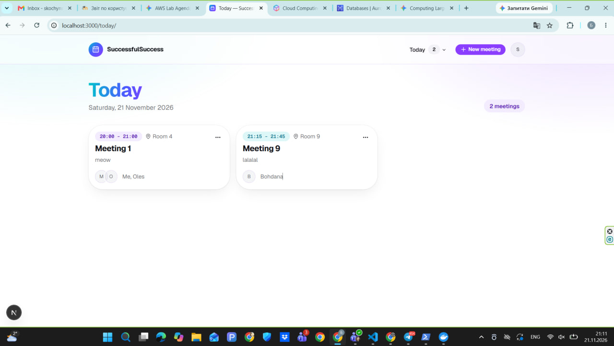

# Lab 9 — One project, two clouds: Spry on Google Cloud

**I took the no-GCP-account route: nothing is deployed on Google Cloud; the Terraform is validated, and the app runs locally the way Cloud Run runs it.**

## 1. Code and ADR

- Commit with `gcp/` and `docs/adr/`: https://github.com/bskochynska/SuccessfulSuccess/commits/main/gcp (the latest commit on `main` that touches `gcp/`)
- ADR: [`docs/adr/0003-gcp-migration-architecture.md`](docs/adr/0003-gcp-migration-architecture.md) (table with a decision for every row, the database, e-mail and "what does not move" answers)
- Terraform output, run in `gcp/` with `terraform init -backend=false` (no Google or HCP credentials needed):

`gcp/init_output.txt` and `gcp/validation_output.txt` hold the output (plain UTF-8 text).

> TODO before submitting: the configuration was edited after that run (secret for `DATABASE_URL`, Direct VPC egress, roles, the `cloud` block). Run `terraform init -backend=false && terraform validate` in `gcp/` on your machine, replace the two files with the new output (`terraform validate > validation_output.txt` in PowerShell writes UTF-16; use `cmd /c` or `| Out-File -Encoding utf8`) and commit them.

What the configuration does: enables the APIs; two service accounts (Terraform, and the one the API runs as) with the roles from the lab and no JSON keys; Artifact Registry; Cloud SQL PostgreSQL `db-f1-micro`, 10 GB SSD, private IP; a generated password; the full `DATABASE_URL` in Secret Manager, which Cloud Run reads through `secret_key_ref`; Cloud Run with min instances 0, the Cloud SQL socket and Direct VPC egress. Its own state: HCP Terraform workspace `spry-gcp`.

## 2. The app, ready for Cloud Run, running locally

The backend image has no Lambda adapter (`mangum` removed) and listens on `PORT`. `scripts/local-cloud-run-test.sh` builds it and runs it next to PostgreSQL as Cloud Run would (`-e PORT=8080 -p 8080:8080`), then calls `/health` (a `SELECT 1`) and checks that `/api/v1/meetings` refuses a request without a token.

Screenshot, frontend on `localhost:3000` showing meetings read from the database: 

> TODO before submitting: retake the screenshot with the API on port 8080 (`NEXT_PUBLIC_API_BASE_URL=http://localhost:8080 npm run dev`) and add a second screenshot of the `docker run` / `curl http://localhost:8080/health` output.

## 3. Cost of Spry's core, per month

List prices in USD, 730 h a month, AWS us-east-1 and Google Cloud us-central1. Prices for Cloud SQL, Firestore and Cloud Run are the ones from the lab. The Aurora price of $0.12 per ACU-hour and Lambda's free tier are my assumptions: **check them in the AWS Pricing Calculator and against your Lab 4 table before submitting.** Frontend (CloudFront Free plan, Firebase Hosting free plan), registry, secrets and logs are $0 or a few cents on both sides.

Assumptions: Aurora runs at 0.5 ACU while awake, 0 ACU when paused, ~1 GB stored. Cloud SQL `db-f1-micro` with 10 GB SSD. For "busy" I count an API instance that is active all month (Lambda 512 MB; Cloud Run 1 vCPU, 0.5 GiB), which is a worst case; the free tiers (Lambda 1M requests and 400,000 GB-s; Cloud Run 2M requests, 180,000 vCPU-s, 360,000 GiB-s) are subtracted.

| Profile | AWS: Aurora compute | AWS: storage + API | **AWS total** | GCP: Cloud SQL compute (always on) | GCP: storage + API | **GCP total, DB always on** | **GCP total, DB stopped outside use** |
|---|---|---|---|---|---|---|---|
| Nobody | $0 (paused) | $0.10 + $0 | **≈ $0.30** | $7.67 | $1.70 + $0 | **≈ $9.40** | **≈ $1.70** |
| Class demos (10 × 2 h = 20 h) | 20 h × $0.06 = $1.20 | $0.10 + $0 | **≈ $1.40** | $7.67 | $1.70 + $0 | **≈ $9.40** | 20 h × $0.0105 + $1.70 ≈ **$1.90** |
| Office hours (8 h × 22 = 176 h) | 176 h × $0.06 = $10.56 | $0.10 + $0 | **≈ $10.70** | $7.67 | $1.70 + $0 | **≈ $9.40** | 176 h × $0.0105 + $1.70 ≈ **$3.55** |
| Busy around the clock (730 h) | 730 h × $0.06 = $43.80 | $0.10 + Lambda ≈ $15 | **≈ $59** | $7.67 | $1.70 + Cloud Run ≈ $61 | **≈ $70** | — |

**Which cloud is cheaper, and which line decides it?**

- **Nobody and class demos: AWS** ($0.30 and $1.40 against $9.40). The deciding line is the database compute: Aurora pauses, Cloud SQL bills every hour it exists. Stopping Cloud SQL closes most of the gap ($1.70 and $1.90).
- **Office hours: GCP, slightly** ($9.40 against $10.70, and $3.55 if the instance is stopped at night). Aurora is awake 176 h at $0.06; a `db-f1-micro` costs $0.0105 an hour, about six times less per hour than a 0.5 ACU Aurora.
- **Busy around the clock: AWS, about $59 against $70.** Aurora at 0.5 ACU for 730 h is $43.80, but an API instance that is active all month costs more on Cloud Run (about $61 in vCPU-seconds) than on Lambda (about $15 in GB-seconds), so the deciding line is the API's always-active compute. With real traffic spread over the month, both APIs stay near $0 in their free tiers and GCP drops to the $9.40 database line.

**Where is the trap on the GCP side?** Cloud SQL never pauses: a forgotten instance costs $9.40 a month with zero users, and a stopped one still bills its 10 GB of storage ($1.70). Aurora's trap is something keeping it awake; Cloud SQL's trap is that it is always awake. A second trap is Cloud Run with minimum instances above 0 (or instance-based billing), which turns "scale to zero" into a continuous charge.

**Firestore instead of Cloud SQL** would make an idle month $0 (free quota: 50,000 reads and 20,000 writes a day, 1 GiB), but Spry's tables, relations and Alembic migrations would have to be rewritten as documents, so the ADR keeps Cloud SQL and stops it when not in use.

## 4. Demos without a Google Cloud bill

- Colab notebook (my copy, shared as "Anyone with the link can view", outputs saved): https://colab.research.google.com/drive/1WGe6QnkvysOkTdGU6juMfq7vAvos7YqO#scrollTo=i0thwaeLjzd7
- Looker Studio dashboard (Our World in Data CO₂): https://datastudio.google.com/reporting/de323bd9-0387-49d9-9db1-9f68c32bf723

The three sentences (fill in with your own results from the notebook):

1. **Markdown or image?** TODO: which input gave the better JSON for Qwen3-VL 2B, the Markdown or the image, and why.
2. **Time and hardware:** TODO: how long sections 4 and 5 took, and on which runtime (free CPU or T4).
3. **Document AI:** TODO: when you would pay for Document AI instead (for example: many pages, forms and tables that must come out the same every time, no GPU to run a model, an SLA and audit needs).

## 5. Clean up

Nothing was created on Google Cloud, so there is nothing to delete. If you apply this configuration later: `terraform destroy` in `gcp/`, or stop the database with `gcloud sql instances patch INSTANCE --activation-policy=NEVER` (storage is still billed).
